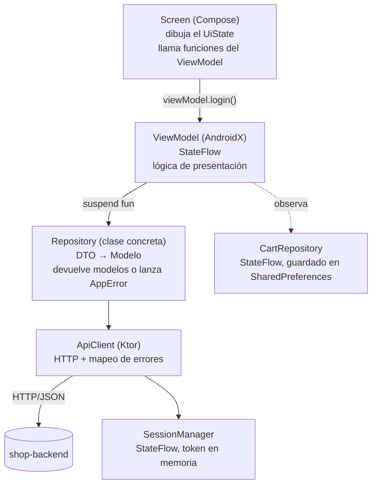

# Arquitectura de la app Android ShopLab (propuesta)

Actualizado: 2026-10-19 · **Estado: propuesta para revisión.** Nada de lo que sigue está construido todavía.

Documento técnico para construir la app Android de ShopLab con **MVVM**, principios **SOLID** y **Ktor** para hablar con el backend, escrito para que lo mantenga una persona de **perfil junior**. Parte de lo que se hizo y se aprendió en la app iOS (iteraciones 1 a 11-opc), que es la referencia funcional y de estructura.

| Documento | Para qué |
| --- | --- |
| [Comportamiento de las apps](comportamiento-apps-moviles.md) | **Qué** hace cada pantalla (común a iOS y Android). Manda sobre este documento |
| [Guía de integración](guia-integracion-ios-android.md) | Contrato del backend: endpoints, errores, datos semilla |
| [Catálogo de IDs](catalogo-ids-accesibilidad.md) | IDs de accesibilidad y textos de alertas (los mismos que iOS) |
| [Arquitectura iOS](../../ecommerce_shop_ios/docs/shop-ios-arquitectura.md) | La referencia de la que sale este documento |
| [Imágenes de producto](imagenes-producto/) | Los 7 SVG que Android convierte a *vector drawable* |

---

## 1. Resumen y decisiones por defecto

La idea central es **la misma arquitectura que iOS, escrita en el idioma de Android**: capas pequeñas, clases concretas, errores traducidos en un solo lugar y reglas de negocio en funciones puras que se prueban sin pantalla.

| Tema | Decisión propuesta | Por qué (en una línea) | Alternativa |
| --- | --- | --- | --- |
| Lenguaje y UI | Kotlin + **Jetpack Compose** (Material 3) | Es la UI actual de Android y se parece a SwiftUI | XML + Views: más código y más archivos |
| Patrón | **MVVM** con `ViewModel` de AndroidX y `StateFlow` | Es lo que Google recomienda y lo que ya hicimos en iOS | MVI: más ceremonia para un junior |
| Red | **Ktor Client** (motor OkHttp) + `kotlinx.serialization` | Lo pediste; una clase `ApiClient` lo encapsula | Retrofit: más rápido de escribir, pero no era la condición |
| Inyección de dependencias | **Manual**, con una clase `AppContainer` | Se lee de arriba abajo, sin anotaciones ni generación de código | Hilt o Koin: ver §3.4 |
| Capas | `Screen → ViewModel → Repository → ApiClient`, **sin** capa de casos de uso | Igual que iOS: menos archivos, mismo resultado | `UseCase`/`domain`: solo si una lógica la comparten dos ViewModels |
| Estado de una pantalla | Una `data class UiState` + `StateFlow` | Una sola fuente de verdad por pantalla | Varias `MutableState` sueltas |
| Dinero | `BigDecimal`, nunca `Double` | Evita `59.990000000000002` | — |
| Fechas | `java.time` (`Instant`, `LocalDate`) | Ya trae hasta nanosegundos; sin librerías | `kotlinx-datetime` |
| Persistencia local | `SharedPreferences` con JSON (carrito y tema) | Es el equivalente de `UserDefaults`, sin corrutinas extra. Room o SQLite no aportan nada con 3 KB de datos sin consultas | `DataStore`: más moderno, más código |
| Navegación | **Navigation Compose** con rutas de texto | Estándar; una pila por pestaña | Librerías externas (Voyager, Decompose) |
| `minSdk` | **26** (Android 8.0) | `java.time` viene de serie, sin *desugaring* | 24 con *desugaring*: más configuración |
| Pruebas | Unitarias + **integración contra el backend real**; UI con Maestro | Igual que iOS: sin mocks ni fakes | `MockEngine` de Ktor: contradice la regla del proyecto |

Las decisiones marcadas con "alternativa" son del responsable (ver §14).

---

## 2. Lo que aprendimos en iOS y se traslada a Android

Cada fila costó tiempo en iOS; en Android conviene hacerla bien desde la primera iteración.

| Lección en iOS | Qué hacer en Android |
| --- | --- |
| Un `Decimal` leído por `Double` daba `59.990000000000002` | `BigDecimal` con un serializador propio que lee el texto del número (§5.4) |
| Los errores del usuario salen del `code` del backend, nunca de su `message` | Un único `ErrorMessages` (§5.2) |
| Un 401 se gestiona en **un solo lugar** | `ApiClient` cierra la sesión; las pantallas no lo ven (§5.5) |
| `ForcedError` y las cabeceras `X-Force-Error` / `X-Delay` permiten ver la alerta genérica sin apagar el backend | Mismos hooks, solo en `debug` (§11) |
| Las reglas de validación en una función pura se probaron sin pantalla y no volvieron a fallar | `RegisterValidator`, `CheckoutValidator`: funciones puras con JUnit (§8) |
| "Try again" de la compra **no reenvía**: reabre la confirmación | Mismo comportamiento (§7.4) |
| El carrito necesita `reconcile` con el stock real al aparecer | Misma operación en `CartRepository` (§6) |
| El catálogo de IDs es contrato: un ID que falta rompe las suites | Objeto `TestTags` copiado del catálogo y una prueba que lo compara (§10) |
| Maestro trata el texto como **regex** (`"Place order?"` también encuentra `Place order`) | Aplica igual en Android: los flujos ya lo escapan |
| Un toque sobre un botón tapado por el teclado cae sobre las teclas | En Compose, `imePadding()` y `scrollable` en cada formulario (§8.3) |
| Autorrelleno de contraseñas del simulador cubre el campo de password | Apagarlo en el emulador (Ajustes → Contraseñas) antes de las pruebas |
| Lo hecho en iteraciones pequeñas con TDD, revisado por el responsable, se mantuvo estable | Mismo flujo: una iteración = un cambio de OpenSpec (§13) |

---

## 3. Arquitectura

### 3.1 Capas



### 3.2 Qué hace cada capa

| Capa | Responsabilidad | Nunca |
| --- | --- | --- |
| **Screen** (`@Composable`) | Dibujar el `UiState`, enlazar campos con funciones del ViewModel, mostrar diálogos | Llamar a `ApiClient` o a un repositorio; tener lógica de negocio |
| **ViewModel** | Guardar el `UiState`, validar formularios, decidir qué alerta mostrar, llamar repositorios | Conocer Ktor, DTOs, `Context` ni `Activity` |
| **Repository** | Llamar a `ApiClient` y convertir DTOs en modelos de la app | Conocer la UI |
| **ApiClient** | Request, códigos HTTP, convertir errores en `AppError` | Tener reglas de negocio |
| **SessionManager** | Guardar el token y avisar cuando la sesión termina o expira | Hacer requests |
| **Validators y formatos** | Reglas puras (`RegisterValidator`, `DisplayFormat`) | Depender de Android |

### 3.3 Cómo viajan los datos

- **Ida:** el usuario toca un botón → `onClick = viewModel::login` → el ViewModel lanza `viewModelScope.launch` → llama `authRepository.login(...)` → el repositorio usa `ApiClient` → Ktor.
- **Vuelta:** JSON → `LoginResponseDto` → el repositorio devuelve el modelo o lanza `AppError` → el ViewModel hace `_state.update { ... }` → Compose redibuja solo lo que cambió.
- **Estado compartido:** `CartRepository` y `SessionManager` son una sola instancia (las crea `AppContainer`) y exponen un `StateFlow`. Catálogo, Detalle, Carrito, Checkout y la insignia de la pestaña lo observan.
- **Sesión expirada:** `ApiClient` recibe 401 con `AUTH_TOKEN_EXPIRED`, `_INVALID` o `_MALFORMED` → `session.expire()` → el `NavHost` raíz, que observa `session`, muestra el login con el aviso. El carrito se conserva.
- **Token ausente:** `AUTH_TOKEN_MISSING` es un bug de la app: `session.end()` y vuelta al login **sin** aviso.

### 3.4 SOLID, aplicado de forma sencilla

SOLID se usa como **guía para decidir dónde poner el código**, no como una lista de interfaces que crear. Para un perfil junior, una interfaz que solo tiene una implementación es código extra sin beneficio.

| Principio | Cómo se aplica aquí | Ejemplo concreto |
| --- | --- | --- |
| **S** · Responsabilidad única | Cada clase tiene una razón para cambiar | `ApiClient` solo habla HTTP; `ErrorMessages` solo traduce códigos; `RegisterValidator` solo valida |
| **O** · Abierto/cerrado | Añadir sin editar lo que ya funciona | Un error nuevo del backend = una línea en el mapa de `ErrorMessages`; un producto nuevo = un `drawable` y una entrada en `ProductImage` |
| **L** · Sustitución de Liskov | Los tipos que representan "uno de varios" se pueden usar sin condiciones extra | `AppError` es una `sealed class`: el `when` obliga a tratar todos los casos |
| **I** · Segregación de interfaces | Las pantallas reciben solo lo que usan | Una pantalla recibe su `UiState` y funciones, no el `AppContainer` entero |
| **D** · Inversión de dependencias | Las clases **reciben** lo que necesitan por constructor y no lo crean ellas | `LoginViewModel(authRepository)`; `AppContainer` es el único que hace `new` |

**Sobre la D, con honestidad:** el principio pide depender de abstracciones. Aquí se aplica la mitad que da valor (inyección por constructor, que permite probar cada pieza contra el backend real) y **no** se crea una interfaz por repositorio. Si algún día hay una segunda implementación real (por ejemplo, una fuente de datos distinta), se extrae la interfaz en ese momento.

**Regla de decisión para el equipo:** una interfaz o clase abstracta se crea solo si hay **dos implementaciones reales hoy**.

**Sobre Hilt y Koin:** inyectar a mano con `AppContainer` son unas 40 líneas y se entienden sin conocer anotaciones ni generación de código. Hilt añade un plugin, anotaciones y errores de compilación difíciles de leer; Koin es más simple, pero esconde dónde se crea cada cosa. Si el equipo ya domina uno, es una decisión válida (§14).

---

## 4. Estructura del proyecto

Un solo módulo `app`, organizado **por funcionalidad** (como las carpetas `Features` de iOS):

```
app/src/main/
├── AndroidManifest.xml
├── res/
│   ├── drawable/                 ← product_headphones.xml … product_placeholder.xml (vectores)
│   └── xml/network_security_config.xml
└── java/co/com/learningswift/shop/
    ├── ShopApplication.kt        ← crea el AppContainer
    ├── MainActivity.kt           ← setContent { ShopApp(container) }
    ├── app/
    │   ├── AppContainer.kt       ← crea y comparte las dependencias
    │   ├── ShopApp.kt            ← raíz: login o pestañas según la sesión
    │   ├── Routes.kt             ← rutas de navegación
    │   └── ViewModelFactories.kt
    ├── core/
    │   ├── network/              ← ApiClient, ErrorDto, AppConfig
    │   ├── errors/               ← AppError, ErrorMessages, FieldErrorMapper
    │   ├── session/              ← SessionManager
    │   ├── formatting/           ← Money.kt, DisplayFormat.kt
    │   ├── design/               ← ProductImage, ProductImageView, componentes comunes
    │   └── testing/              ← TestTags, ForcedError (solo debug)
    ├── data/
    │   ├── model/                ← Product, CartItem, Order, User, Country, Plan…
    │   ├── remote/dto/           ← ProductDto, OrderDto… (@Serializable)
    │   └── repository/           ← AuthRepository, ProductRepository, CartRepository…
    └── features/
        ├── login/                ← LoginScreen, LoginViewModel, LoginUiState
        ├── register/
        ├── catalog/
        ├── productdetail/
        ├── cart/
        ├── checkout/
        ├── confirmation/
        ├── account/
        └── orders/
app/src/test/                     ← unitarias e integración (corren en la JVM del equipo)
app/src/androidTest/              ← opcional: pruebas de Compose en el emulador
```

Cada carpeta de `features/` tiene **tres archivos**: `XxxScreen.kt`, `XxxViewModel.kt` y `XxxUiState.kt`. Quien abra una pantalla sabe dónde está cada cosa.

---

## 5. Piezas clave (código de referencia)

### 5.1 Dependencias

En `gradle/libs.versions.toml`, con las versiones estables vigentes **al crear el proyecto**. Ktor está en la **3.6.0** (revisado el 2026-10-19); el resto se toma de las versiones recomendadas por Android Studio en ese momento.

| Dependencia | Para qué |
| --- | --- |
| `io.ktor:ktor-client-core`, `ktor-client-okhttp` | Cliente HTTP con el motor OkHttp (el estándar en Android) |
| `io.ktor:ktor-client-content-negotiation`, `ktor-serialization-kotlinx-json` | Convertir el JSON |
| `io.ktor:ktor-client-logging` | Solo en `debug`, para ver las peticiones |
| `org.jetbrains.kotlinx:kotlinx-serialization-json` + el plugin `kotlin.plugin.serialization` | `@Serializable` |
| Compose BOM, Material 3, `activity-compose`, `navigation-compose`, `lifecycle-viewmodel-compose`, `lifecycle-runtime-compose` | UI y estado |
| `kotlinx-coroutines-test`, JUnit | Pruebas |

**Sin** Hilt, Room, Retrofit ni módulos de dominio.

### 5.2 Errores y mensajes para el usuario

```kotlin
/** Todo lo que puede salir mal en una operación de red, ya traducido por ApiClient */
sealed class AppError : Exception() {
    data object Network : AppError()
    data object SessionExpired : AppError()      // AUTH_TOKEN_EXPIRED, _INVALID o _MALFORMED
    data object NotAuthenticated : AppError()    // AUTH_TOKEN_MISSING: la app no envió el token (bug)
    data object Unknown : AppError()
    data class Api(
        val status: Int,
        val code: String,
        val message: String,                      // técnico: NUNCA se muestra
        val fieldErrors: Map<String, List<String>>,
    ) : AppError()

    val userMessage: String get() = ErrorMessages.messageFor(this)
}

object ErrorMessages {
    private val byCode = mapOf(
        "INVALID_CREDENTIALS" to "The email or password is incorrect.",
        "USER_LOCKED" to "Your account is locked. Please contact support.",
        "EMAIL_ALREADY_EXISTS" to "An account with this email already exists.",
        "UNDERAGE_USER" to "You must be at least 18 years old to register.",
        "PRODUCT_NOT_FOUND" to "This product is no longer available.",
        "INSUFFICIENT_STOCK" to "Some products in your cart don't have enough stock. Please update the quantities.",
        // …la tabla completa está en Comportamiento §11.1 y en `AlertText`
    )
    private const val GENERIC = "Something went wrong. Please try again."

    fun messageFor(error: AppError): String = when (error) {
        is AppError.Api -> byCode[error.code] ?: GENERIC
        AppError.SessionExpired -> "Your session has expired. Please log in again."
        AppError.Network, AppError.NotAuthenticated, AppError.Unknown -> GENERIC
    }
}
```

`sealed class` hace que un `when` **sin `else`** falle al compilar si se añade un error nuevo y no se trata: es el "Liskov" del equipo. Los textos de las alertas (título, botones) van en un `object AlertText` igual que en iOS.

### 5.3 Cliente HTTP con Ktor

```kotlin
class ApiClient(
    private val baseUrl: String,
    private val session: SessionManager,
    engineClient: HttpClient? = null,
) {
    private val client = engineClient ?: HttpClient(OkHttp) {
        expectSuccess = false                                   // los 4xx y 5xx los mapeamos nosotros
        install(ContentNegotiation) { json(AppJson) }
        install(HttpTimeout) { requestTimeoutMillis = 15_000 }  // cubre el retraso máximo de X-Delay (10 s)
    }

    suspend inline fun <reified Response> get(path: String, authorized: Boolean = false): Response =
        send(HttpMethod.Get, path, body = null, authorized = authorized)

    suspend inline fun <reified Body : Any, reified Response> post(
        path: String, body: Body, authorized: Boolean = false, headers: Map<String, String> = emptyMap(),
    ): Response = send(HttpMethod.Post, path, body, authorized, headers)

    suspend inline fun <reified Response> send(
        method: HttpMethod, path: String, body: Any?, authorized: Boolean,
        headers: Map<String, String> = emptyMap(),
    ): Response {
        val response = try {
            client.request(baseUrl + path) {
                this.method = method
                headers.forEach { (name, value) -> header(name, value) }
                if (authorized) session.token?.let { bearerAuth(it) }
                if (body != null) { contentType(ContentType.Application.Json); setBody(body) }
            }
        } catch (e: CancellationException) {
            throw e                                              // NUNCA tragarse la cancelación de una corrutina
        } catch (e: IOException) {
            throw AppError.Network
        }

        if (response.status.value !in 200..299) throw mapError(response)
        return try { response.body() } catch (e: SerializationException) { throw AppError.Unknown }
    }

    private suspend fun mapError(response: HttpResponse): AppError {
        val body = runCatching { response.body<ErrorDto>() }.getOrNull()
        val code = body?.code ?: "UNKNOWN"
        val status = response.status.value

        if (status == 401 && code == "AUTH_TOKEN_MISSING") { session.end(); return AppError.NotAuthenticated }
        if (status == 401 && code.startsWith("AUTH_TOKEN")) { session.expire(); return AppError.SessionExpired }

        // Un campo puede traer varios mensajes: se conservan todos
        val fields = body?.fieldErrors.orEmpty().groupBy({ it.field }, { it.message })
        return AppError.Api(status, code, body?.message.orEmpty(), fields)
    }
}
```

Puntos que un junior debe conocer:

- **`CancellationException` se relanza siempre.** Si se captura con un `catch (e: Exception)` genérico, al salir de una pantalla la corrutina no se cancela bien. Es el error más común con Ktor y corrutinas.
- **`expectSuccess = false`**: Ktor lanza por defecto una excepción en 4xx/5xx; aquí queremos leer el cuerpo del error y decidir nosotros.
- **`inline reified`** es lo que permite `response.body<T>()` sin pasar la clase; si algo no compila por eso, es normal: la función auxiliar debe ser `inline` también.
- La `baseUrl` termina en `/` (`http://10.0.2.2:8080/api/v1/`) y los `path` **no** empiezan por `/`. Se comprueba con un test de integración (§12).

### 5.4 JSON: montos, fechas y la fecha de nacimiento

```kotlin
val AppJson = Json {
    ignoreUnknownKeys = true      // el backend puede añadir campos sin romper la app
    explicitNulls = false         // no envía los campos nulos (por ejemplo, un teléfono vacío)
}

/** 59.99 se lee como el texto "59.99", nunca como Double (que daría 59.990000000000002) */
object BigDecimalSerializer : KSerializer<BigDecimal> {
    override val descriptor = PrimitiveSerialDescriptor("BigDecimal", PrimitiveKind.STRING)
    override fun deserialize(decoder: Decoder): BigDecimal {
        val element = (decoder as JsonDecoder).decodeJsonElement() as JsonPrimitive
        return BigDecimal(element.content).setScale(2, RoundingMode.HALF_UP)
    }
    override fun serialize(encoder: Encoder, value: BigDecimal) =
        (encoder as JsonEncoder).encodeJsonElement(JsonUnquotedLiteral(value.toPlainString()))
}
```

- **Fechas:** `Instant.parse("2026-10-19T15:18:01.797548Z")` ya acepta hasta 9 decimales. En iOS hizo falta un analizador propio; en Android no.
- **Fecha de nacimiento:** el backend recibe `yyyy-MM-dd` como **texto**. Se envía `LocalDate.toString()`; nunca una fecha con hora ni zona.
- **Mostrar montos:** `NumberFormat.getCurrencyInstance(Locale.US)` da `$59.99`. Se centraliza en `Money.kt` (equivalente a `Decimal.usd`).

### 5.5 Sesión

```kotlin
/** El token vive solo en memoria (fase 1): al cerrar la app hay que volver a iniciar sesión */
class SessionManager {
    private val _state = MutableStateFlow(SessionState())
    val state: StateFlow<SessionState> = _state.asStateFlow()
    val token: String? get() = _state.value.token

    fun start(token: String) { _state.value = SessionState(token = token) }
    fun end() { _state.value = SessionState() }                          // logout o AUTH_TOKEN_MISSING
    fun expire() { _state.value = SessionState(didExpire = true) }       // lleva el aviso al login
}

data class SessionState(val token: String? = null, val didExpire: Boolean = false) {
    val isLoggedIn: Boolean get() = token != null
}
```

### 5.6 Repositorio

```kotlin
class ProductRepository(private val api: ApiClient) {
    suspend fun products(): List<Product> =
        api.get<List<ProductDto>>("products").map { it.toModel() }

    /** Un producto inexistente lanza PRODUCT_NOT_FOUND */
    suspend fun product(id: Long): Product =
        api.get<ProductDto>("products/$id").toModel()
}
```

Los DTO son `@Serializable data class` y tienen un `toModel()`. Los modelos (`Product`, `Order`…) son `data class` **sin** anotaciones de red: la UI nunca ve un DTO.

### 5.7 ViewModel y UiState (el patrón de todas las pantallas)

```kotlin
data class LoginUiState(
    val email: String = "",
    val password: String = "",
    val errorMessage: String? = null,   // credenciales o cuenta bloqueada: se muestra en línea
    val isLoading: Boolean = false,
    val genericError: AppError? = null, // cualquier otro: alerta genérica
) {
    val isLoginEnabled: Boolean get() = email.isNotBlank() && password.isNotBlank() && !isLoading
}

class LoginViewModel(private val authRepository: AuthRepository) : ViewModel() {
    private val _state = MutableStateFlow(LoginUiState())
    val state: StateFlow<LoginUiState> = _state.asStateFlow()

    fun onEmailChange(value: String) =
        _state.update { it.copy(email = value, errorMessage = if (value.isBlank()) null else it.errorMessage) }

    fun onPasswordChange(value: String) = _state.update { it.copy(password = value) }

    fun login() {
        if (!_state.value.isLoginEnabled) return          // evita un doble envío
        viewModelScope.launch {
            _state.update { it.copy(isLoading = true, errorMessage = null) }
            try {
                authRepository.login(_state.value.email, _state.value.password)
                // No navega: la raíz cambia de pantalla al detectar la sesión
            } catch (e: AppError) {
                val inline = e is AppError.Api && e.code in setOf("INVALID_CREDENTIALS", "USER_LOCKED")
                _state.update { if (inline) it.copy(errorMessage = e.userMessage) else it.copy(genericError = e) }
            } finally {
                _state.update { it.copy(isLoading = false) }
            }
        }
    }

    fun dismissGenericError() = _state.update { it.copy(genericError = null) }
}
```

Reglas del equipo para todo ViewModel:

1. **Un `UiState` inmutable** por pantalla; solo se cambia con `_state.update { it.copy(...) }`.
2. Las funciones públicas son **verbos** que la pantalla llama (`login()`, `onEmailChange()`); no se expone el `MutableStateFlow`.
3. Se atrapa `AppError` (nunca `Exception` a secas, para no tragarse la cancelación).
4. El ViewModel **no navega**: cambia estado y la pantalla o la raíz reaccionan.
5. Una acción que ya está en curso se ignora (`isLoading`).

### 5.8 Screen

```kotlin
@Composable
fun LoginScreen(viewModel: LoginViewModel, sessionExpired: Boolean, onRegisterTap: () -> Unit) {
    val state by viewModel.state.collectAsStateWithLifecycle()

    Column(Modifier.fillMaxSize().imePadding().verticalScroll(rememberScrollState()).padding(24.dp)) {
        if (sessionExpired) MessageBanner(AppError.SessionExpired.userMessage, Modifier.testTag(TestTags.Login.SESSION_EXPIRED_TEXT))

        OutlinedTextField(
            value = state.email, onValueChange = viewModel::onEmailChange,
            label = { Text("Email") },
            modifier = Modifier.fillMaxWidth().testTag(TestTags.Login.EMAIL_INPUT),
        )
        // …password, mensaje de error en línea, botones…
        Button(
            onClick = viewModel::login, enabled = state.isLoginEnabled,
            modifier = Modifier.fillMaxWidth().testTag(TestTags.Login.SUBMIT_BUTTON),
        ) { Text("Log in") }
    }

    state.genericError?.let { error ->
        GenericErrorDialog(error, onRetry = viewModel::login, onDismiss = viewModel::dismissGenericError)
    }
}
```

La pantalla recibe el **ViewModel** y los datos que necesita, no el contenedor. Un composable que solo dibuja (sin ViewModel) se llama `XxxContent(state, onEvent…)`: se puede mostrar en un `@Preview` sin backend.

### 5.9 Contenedor de dependencias y raíz

```kotlin
class AppContainer(baseUrl: String, preferences: SharedPreferences) {
    val session = SessionManager()
    val snackbar = SnackbarCenter()
    private val api = ApiClient(baseUrl, session)

    val authRepository = AuthRepository(api, session)
    val productRepository = ProductRepository(api)
    val orderRepository = OrderRepository(api)
    val cart = CartRepository(preferences)
    val settings = SettingsRepository(preferences)
}

class ShopApplication : Application() {
    lateinit var container: AppContainer
    override fun onCreate() {
        super.onCreate()
        container = AppContainer(AppConfig.baseUrl(this), getSharedPreferences("shop", MODE_PRIVATE))
    }
}
```

Los ViewModel se crean con una `Factory` que saca los repositorios del contenedor (`viewModelFactory { initializer { LoginViewModel(container.authRepository) } }`), todas en un único archivo `ViewModelFactories.kt`.

`ShopApp` observa `session.state`: si `isLoggedIn`, muestra las pestañas; si no, el flujo de login y registro.

---

## 6. Carrito guardado en el dispositivo

Mismas reglas que iOS (Comportamiento §7): una línea por producto, **máximo 20 unidades**, nunca más que el stock, `reconcile` con el stock real al aparecer, se vacía al comprar y al cerrar sesión.

```kotlin
@Serializable data class CartItem(val productId: Long, val name: String, val imageKey: String,
    @Serializable(with = BigDecimalSerializer::class) val unitPrice: BigDecimal, val quantity: Int)

class CartRepository(private val preferences: SharedPreferences) {
    private val _items = MutableStateFlow(load())
    val items: StateFlow<List<CartItem>> = _items.asStateFlow()

    val totalQuantity get() = _items.value.sumOf { it.quantity }
    val isFull get() = totalQuantity >= MAX_TOTAL_QUANTITY

    fun maxAddable(product: Product): Int {
        val byStock = product.stock - quantityOf(product.id)
        val byCart = MAX_TOTAL_QUANTITY - totalQuantity
        return maxOf(0, minOf(byStock, byCart))
    }

    fun add(product: Product, quantity: Int) { /* suma a su línea o crea una; nunca supera maxAddable */ save() }
    fun setQuantity(quantity: Int, productId: Long, stock: Int) { /* entre 1 y el máximo permitido */ save() }
    fun remove(productId: Long) { /* … */ save() }
    fun clear() { _items.value = emptyList(); save() }
    fun reconcile(products: List<Product>): Boolean { /* baja cantidades, quita agotados; true si cambió algo */ }

    companion object { const val MAX_TOTAL_QUANTITY = 20 }
}
```

`setQuantity` recibe el `stock` como parámetro porque el carrito no lo guarda: un stock guardado se queda viejo. La regla del botón "Add to cart" (`Disabled`, `CartFull` o `OpenSheet`) vive en una función pura, `addToCartAction(product, cart)`, que comparten la fila del catálogo y el detalle.

### 6.1 Datos sensibles: cifrado con Tink y Android Keystore

`EncryptedSharedPreferences` (`androidx.security:security-crypto`) **está obsoleta**: Google marcó todas sus APIs como tal en la 1.1.0-alpha07 (abril de 2025) "en favor de las APIs de la plataforma y del uso directo de Android Keystore", y la 1.1.0 estable (julio de 2025) no recibirá más desarrollo. **No se usa.**

Lo que usa el proyecto, y que es lo más extendido hoy:

| Pieza | Para qué |
| --- | --- |
| **Android Keystore** | Guarda la clave maestra; es no exportable y nunca sale del dispositivo |
| **Tink** (`tink-android` 1.24.0), AEAD AES-256-GCM | Cifra con integridad (si alguien altera el dato, no se descifra) y gestiona el juego de claves (`AndroidKeysetManager`) |
| `EncryptedKeyValueStore` | Decorador de `KeyValueStore`: cifra cada valor antes de entregarlo al almacenamiento y lo descifra al leerlo. Quien lo usa no cambia |
| `AndroidKeystoreAead.create(context)` | Crea el `Aead` con su clave en Keystore |
| `AppContainer.secureStore` | Se crea la primera vez que se usa, no al arrancar la app |

Reglas:

- La **clave** del par clave-valor viaja como *datos asociados* del cifrado: un valor cifrado no se puede copiar a otra clave.
- Si el dato se altera o la clave del dispositivo se pierde, `getString` devuelve `null` (como si no existiera): el usuario simplemente vuelve a iniciar sesión.
- **Sin copias de seguridad:** `android:allowBackup="false"` y las reglas `data_extraction_rules.xml` y `backup_rules.xml` excluyen todo, porque un dato cifrado con una clave que no viaja con él no se podría leer tras restaurarlo.
- **Pruebas:** el cifrado se prueba en la JVM con un juego de claves de Tink en memoria (cifrado real, sin mocks); la parte de Keystore, solo en el emulador (`androidTest`).
- **Por qué no `datastore-tink`:** existe (`DataStore` + `AeadSerializer`), pero a 2026-10-19 solo tiene versiones `1.3.0-alpha` y `rc`, sin versión estable. Cuando la tenga, el cambio es de esta clase y de quien la crea.
- **Por qué no Keystore a pelo:** exige gestionar a mano el IV, el modo y las particularidades por versión de Android; Tink lo resuelve y es lo que recomiendan las guías actuales.

La sesión **sigue siendo solo en memoria** en la fase 1; persistir el token es una decisión de producto (decisión #6 del §14).

---

## 7. Navegación y pantallas

### 7.1 Estructura

- `ShopApp`: si no hay sesión, `NavHost` de autenticación (`login → register → registerDetails`); si la hay, `Scaffold` con `NavigationBar` de tres pestañas (Catalog, Cart, Account).
- **Cada pestaña tiene su propia pila** (`rememberNavController()` por pestaña). El detalle de producto, el checkout, la confirmación, "My orders" y el detalle de orden son destinos de esa pila.
- Las rutas son constantes de texto en `Routes.kt` (`"product/{id}"`); el id se pasa como argumento `Long`.

### 7.2 Hojas, diálogos y snackbar

| Elemento | Compose |
| --- | --- |
| Hoja "Add to cart" | `ModalBottomSheet` |
| Alertas ("Place order?", "Cart is full", "Log out?") | `AlertDialog` |
| Confirmación de "Clear cart" | `AlertDialog` (en Android no hay hoja de acciones; el catálogo de IDs ya lo prevé como diálogo) |
| Snackbar "Added to cart" | `SnackbarHost` con 3 s, con el ID `app_snackbar_text` |
| Alerta genérica | Un `GenericErrorDialog` único con "Try again" y "Cancel" |

### 7.3 Confirmación de la compra sin botón de atrás

`BackHandler(enabled = true) { }` en la pantalla de confirmación, y la barra superior sin flecha. "Done" vacía la pila y cambia a la pestaña Catalog.

### 7.4 "Try again" de la compra

Como en iOS, cuando la compra falla por un error genérico, "Try again" **reabre "Place order?"** y no reenvía la orden: el backend no es idempotente y un reintento ciego podría crear dos órdenes.

---

## 8. Formularios y validación

### 8.1 Reglas en funciones puras

`RegisterValidator` y `CheckoutValidator` son `class` o `object` **sin dependencias de Android**: reciben el formulario y devuelven un `Map<Campo, String>`. Las reglas y sus mensajes son las de Comportamiento §5 y §8 (la app puede ser más estricta que el backend; el backend sigue siendo la última palabra). Se prueban con JUnit, sin emulador.

### 8.2 Patrón de formulario (igual que iOS)

1. El botón de envío está **siempre habilitado** (cada error debe poder provocarse).
2. Al pulsarlo se valida todo; con errores no se llama al backend, se muestra el **resumen** ("N fields need attention") y la pantalla se desplaza al primer campo con error.
3. Tras el primer intento, cada campo se revalida **al perder el foco** (`onFocusChanged`).
4. El error de un campo desaparece en cuanto se edita.
5. Los `fieldErrors` del backend se muestran tal como llegan, solo como red de seguridad (`FieldErrorMapper`, genérico, igual que en iOS).

### 8.3 Teclado

Cada formulario es `verticalScroll` con `imePadding()`, y el campo con foco se desplaza a la vista (`BringIntoViewRequester`). Es lo que evitó en iOS que el teclado tapara el botón de envío.

### 8.4 Fechas y desplegables

La fecha de nacimiento son **tres desplegables** (Day, Month, Year) como filas de una lista, igual que en iOS (`ExposedDropdownMenuBox`). Al cambiar mes o año, el día baja al último del mes si ya no existe.

---

## 9. Imágenes de producto

Es la misma decisión que iOS (iteración 5): **siete ilustraciones planas en SVG, originales del proyecto**, en [`docs/imagenes-producto/`](imagenes-producto/). Ningún derecho de terceros, y las dos apps se ven igual.

### 9.1 Del SVG al recurso de Android

1. En Android Studio: *Resource Manager → + → Vector Asset → Local file (SVG, PSD)* y elegir cada `product_<clave>.svg`.
2. El nombre del recurso es `product_<clave>` (ya es válido: minúsculas y guion bajo). Quedan en `res/drawable/` como `.xml`.
3. **Revisar cada uno a la vista**, en claro y en oscuro: Android Studio convierte `<rect rx>` y `<circle>` a rutas y a veces simplifica; si alguno se ve distinto, ajustar el SVG original (que es la fuente) y volver a importar.
4. No hay variantes por densidad: un vector sirve para todas.

### 9.2 Un solo lugar para el mapeo

```kotlin
/** El único lugar que relaciona el imageKey del backend con el recurso. Una clave nueva se añade aquí y con su drawable */
object ProductImage {
    private val known = mapOf(
        "headphones" to R.drawable.product_headphones,
        "keyboard" to R.drawable.product_keyboard,
        "smartwatch" to R.drawable.product_smartwatch,
        "mouse" to R.drawable.product_mouse,
        "speaker" to R.drawable.product_speaker,
        "backpack" to R.drawable.product_backpack,
    )

    @DrawableRes
    fun resourceFor(imageKey: String): Int = known[imageKey] ?: R.drawable.product_placeholder
}
```

Una clave desconocida devuelve el respaldo; **nunca falla ni queda vacía**. Es lógica pura: se prueba con JUnit (las seis claves tienen su recurso, `"unknown"` y `""` dan el de respaldo, y distingue mayúsculas, como en iOS).

### 9.3 El componente

```kotlin
@Composable
fun ProductImageView(imageKey: String, modifier: Modifier = Modifier, isSoldOut: Boolean = false, soldOutTag: String? = null) {
    Box(modifier.aspectRatio(1f)) {
        Image(
            painter = painterResource(ProductImage.resourceFor(imageKey)),
            contentDescription = null,
            modifier = Modifier.fillMaxSize().testTag(TestTags.productImage(imageKey)),  // ID con la clave recibida
        )
        if (isSoldOut) SoldOutLabel(Modifier.align(Alignment.Center).then(soldOutTag?.let { Modifier.testTag(it) } ?: Modifier))
    }
}
```

- El ID es `product_image_<imageKey>` **con la clave recibida**, aunque se use el respaldo (`product_image_unknown`), igual que en iOS.
- "Sold out" se superpone sin cambiar la imagen; su ID lo pasa la pantalla (en el catálogo y en el detalle es distinto).
- Un `@Preview` muestra las siete imágenes, con y sin "Sold out", en claro y oscuro.

---

## 10. Catálogo de identificadores

Android usa **los mismos IDs** que iOS, tal como dice el [catálogo](catalogo-ids-accesibilidad.md): `Modifier.testTag(...)` más `testTagsAsResourceId = true`.

### 10.1 Cómo se ven en Appium y Maestro

| Qué pones en Compose | Cómo lo ve Appium (UiAutomator2) | Cómo lo ve Maestro |
| --- | --- | --- |
| `Modifier.testTag("login_submit_button")` + `testTagsAsResourceId` | `resource-id` | `id: "login_submit_button"` |
| Texto visible | `text` | texto a secas (regex) |

El `testTagsAsResourceId` se activa **una sola vez**, en la raíz:

```kotlin
@OptIn(ExperimentalComposeUiApi::class)
@Composable
fun ShopApp(container: AppContainer) {
    Box(Modifier.semantics { testTagsAsResourceId = true }) { /* NavHost, diálogos… */ }
}
```

### 10.2 `TestTags`: copia del catálogo, en un solo archivo

```kotlin
/** Copia de catalogo-ids-accesibilidad.md. Un ID nuevo se añade primero al catálogo y luego aquí */
object TestTags {
    object Login {
        const val EMAIL_INPUT = "login_email_input"
        const val PASSWORD_INPUT = "login_password_input"
        const val SUBMIT_BUTTON = "login_submit_button"
        const val REGISTER_LINK = "login_register_link"
        const val SESSION_EXPIRED_TEXT = "login_session_expired_text"
        const val ERROR_TEXT = "login_error_text"
    }
    object Catalog {
        const val LIST = "catalog_list"
        fun item(productId: Long) = "catalog_item_$productId"
        fun itemAddButton(productId: Long) = "catalog_item_${productId}_add_button"
    }
    fun productImage(imageKey: String) = "product_image_$imageKey"
    // …
}
```

Una **prueba unitaria compara `TestTags` con el catálogo** (el equivalente de `AccessibilityIDTests` en iOS): ningún ID del catálogo falta en la app ni sobra en ella. Es lo que cierra el criterio de aceptación de la iteración 11.

### 10.3 Cuidados que ya conocemos

| Tema | Qué hacer |
| --- | --- |
| Contenedores (`catalog_item_<id>`, `cart_item_<id>`) | `Modifier.testTag(...)` en la fila **sin** `semantics(mergeDescendants = true)`; si se fusionan los hijos, sus IDs desaparecen del árbol |
| Diálogos (`AlertDialog`) | Son una **ventana aparte**: hay que repetir `testTagsAsResourceId` en el `modifier` del `AlertDialog` (verificado en la A2); si no, los IDs de sus botones no llegan (a comprobar en la primera iteración con diálogos) |
| Casilla de términos | `Modifier.semantics { stateDescription = if (checked) "checked" else "unchecked" }` |
| Selector de cantidad | Se construye con dos botones con sus IDs propios (`add_to_cart_quantity_stepper` y sus `-Increment` / `-Decrement`, como los expone iOS) para que los flujos de Maestro sean iguales |
| Menú de país | El campo con su ID y cada opción como texto visible (Maestro toca el texto) |
| Errores en línea | Solo existen mientras hay error: no se pintan vacíos |
| Insignia del carrito | `BadgedBox` con el total de unidades |

### 10.4 Los flujos de Maestro se reutilizan

Como los IDs y los textos de las alertas son los mismos, los flujos de [`maestro/`](../../ecommerce_shop_ios/maestro/) de iOS sirven en Android con cambios pequeños: el `appId`, los gestos de teclado y cómo se cierra el selector de cantidad. Conviene pasar el `appId` como variable de entorno en `run.sh` para tener **una sola carpeta de flujos**.

---

## 11. Entorno, red y pruebas manuales

| Dónde corre la app | Base URL | Cómo |
| --- | --- | --- |
| Emulador Android | `http://10.0.2.2:8080/api/v1/` | Valor por defecto en `debug` |
| Dispositivo físico | `http://<nombre-de-la-mac>.local:8080/api/v1/` | Argumento de arranque (abajo) |

**HTTP sin TLS** (solo desarrollo): `res/xml/network_security_config.xml` con `cleartextTrafficPermitted="true"` para `10.0.2.2` y el nombre local de la Mac, y declarado en el `AndroidManifest`. Nunca un `usesCleartextTraffic` general.

**Android 17 (API 37):** conectar con direcciones de red local (`10.0.2.2`, el `.local` de la Mac) exige el permiso de ejecución `ACCESS_LOCAL_NETWORK`; sin él la conexión se agota (`ConnectTimeoutException`, que la app ve como error de red). Se declara solo en el manifiesto de `debug` y `MainActivity` lo pide al arrancar (verificado en la A3). En release no se declara: el backend es público y con HTTPS.

**Argumentos de arranque (solo `debug`, con `BuildConfig.DEBUG`)**, los mismos que iOS pero como *extras* del `Intent`:

```bash
adb shell am start -n co.com.learningswift.shop/.MainActivity \
  --es apiBaseUrl "http://10.0.2.2:8080/api/v1/" \
  --es testSessionToken "<jwt>" --ei testForceError 503 --es testForceErrorPath orders --ei testDelay 3000
```

| Extra | Efecto |
| --- | --- |
| `apiBaseUrl` | Cambia la URL del backend |
| `testSessionToken` | Arranca con la sesión iniciada |
| `testForceError`, `testForceErrorPath` | Añade `X-Force-Error` (a todas las rutas o solo a las que empiezan por ese texto) |
| `testDelay` | Añade `X-Delay` |

Además, en `debug`, un email `force<400–599>@dominio` en el login y el registro hace lo mismo (`ForcedError`), para ver la alerta genérica sin apagar el backend.

---

## 12. Pruebas

Igual que iOS: **sin mocks ni fakes**; el backend real corre con Docker (perfil `testing`).

| Nivel | Qué | Cómo |
| --- | --- | --- |
| Unitario, sin red | `ErrorMessages`, validadores, `FieldErrorMapper`, `DisplayFormat`, `ProductImage`, `TestTags` vs catálogo, `CartRepository` y `SettingsRepository` sobre unas `SharedPreferences` en memoria | JUnit en `app/src/test`; corren en la JVM, sin emulador |
| Integración | Repositorios y ViewModels contra el backend real | También en `app/src/test` (la JVM del equipo llega a `localhost:8080`); `POST /api/v1/test/reset` antes de **cada** test |
| Compose (opcional) | Una pantalla aislada | `androidTest`, solo si hace falta; los flujos completos van con Maestro |
| UI | Flujos completos y alertas | Maestro (los de iOS adaptados) y Appium si se necesita |

```kotlin
class LoginIntegrationTest {
    private val container = TestContainer.create()          // URL del backend y preferencias en memoria

    @Before fun resetBackend() = runBlocking { TestBackend.reset() }   // POST /api/v1/test/reset

    @Test fun wrongPasswordShowsTheBusinessMessage() = runTest {
        val viewModel = LoginViewModel(container.authRepository)
        viewModel.onEmailChange("standard@shoplab.dev")
        viewModel.onPasswordChange("Wrong_123")

        viewModel.login()
        advanceUntilIdle()

        assertEquals("The email or password is incorrect.", viewModel.state.value.errorMessage)
        assertFalse(container.session.state.value.isLoggedIn)
    }
}
```

- **Las suites de integración no se ejecutan en paralelo** (un reset pisaría a otra); se agrupan y se serializan (Gradle: `maxParallelForks = 1` para ese conjunto).
- **`runTest` y `Dispatchers.setMain`:** el ViewModel usa `viewModelScope` (Main); en los tests se reemplaza con un `TestDispatcher` (regla `MainDispatcherRule`).
- **Datos:** `standard@shoplab.dev`, `buyer@shoplab.dev` y `locked@shoplab.dev`, todos con `Secret_123`.
- **Requisito:** el backend levantado; `TestBackend.reset()` comprueba `/actuator/health` y falla con un mensaje claro si no responde.

---

## 13. Cómo construirlo: iteraciones

El plan detallado, con los archivos a crear, los tests y los criterios de aceptación de cada iteración, está en el [plan de iteraciones de Android](plan-iteraciones-android.md). Resumen:

| # | Iteración | Change | Entregable |
| --- | --- | --- | --- |
| A0 | Preparación | — | **HECHO** · OpenSpec, documentos copiados |
| A1 | Base del proyecto | `bootstrap` | **Hecho**: Gradle, tema, red, errores, sesión, cifrado, pestañas |
| A2 | Estructura | `app-shell` | Raíz por sesión, snackbar |
| A3 | Login | `user-login` | Login y sesión |
| A4 | Registro | `user-registration` | Formulario en dos pantallas |
| A5 | Catálogo | `product-catalog` | Imágenes, lista, detalle, "Add to cart" y reglas del carrito |
| A6 | Carrito | `cart` | Pantalla del carrito y refresco del stock |
| A7 | Checkout | `checkout` | Compra y confirmación |
| A8 | Cuenta y órdenes | `account-orders` | Perfil, tema, logout, My orders y detalle |
| A9 | Pruebas móviles | `mobile-testing` | Hooks, flujos de Maestro y revisión de IDs |

Cada iteración es un cambio de OpenSpec, con TDD donde haya lógica, revisión del responsable antes de implementar y commit propio. Los `specs` se copian de los de iOS (son contrato de comportamiento) y se ajustan solo los términos de plataforma.

---

## 14. Decisiones abiertas para el responsable

| # | Decisión | Mi recomendación | Alternativa y su costo |
| --- | --- | --- | --- |
| 1 | Inyección de dependencias | Manual (`AppContainer`) | Hilt: estándar de la industria, pero añade plugin y anotaciones para un perfil junior |
| 2 | Persistencia del carrito y del tema | `SharedPreferences` con JSON | `DataStore`: moderno y asíncrono, con más código de corrutinas |
| 3 | `minSdk` | 26 | 24: llega a más dispositivos pero exige *desugaring* de `java.time` |
| 4 | Motor de Ktor | OkHttp | CIO: sin dependencia de OkHttp, menos probado en Android |
| 5 | Capa de casos de uso (`domain`) | No | Solo si dos ViewModels comparten lógica |
| 6 | Token en almacenamiento seguro | No en la fase 1 (solo memoria, como iOS). El bloque de cifrado ya está en el proyecto base (§6.1) y se usa si se decide persistir el token | `DataStore` + Tink (ver §6.1); **no** `EncryptedSharedPreferences`, que está obsoleta |
| 7 | Repositorio de la app | Uno aparte (`ecommerce_shop_android`), con su carpeta `docs` y una copia del catálogo de IDs | Dentro del repositorio del backend: más simple, mezcla tecnologías |
| 8 | Dispositivos de prueba | Un emulador con API 34 y otro actual | — |

---

## 15. Qué NO hacemos (para mantenerlo simple)

- **Sin módulos Gradle por capa** ni "Clean Architecture" completa: un módulo `app`.
- **Sin interfaces** para repositorios y `ApiClient` mientras haya una sola implementación.
- **Sin `UseCase`** de un solo método que solo llama a un repositorio.
- **Sin librerías** de fechas, de imágenes (Coil) ni de navegación externa: los 7 vectores van empaquetados y `java.time` basta.
- **Sin Double** para dinero, **sin colores fijos** en las pantallas (colores del tema de Material 3).
- **Sin mostrar** el `message` técnico del backend al usuario.
- **Sin lógica de negocio** en un composable.

### Lista de revisión de código (para cada Pull Request)

1. ¿La pantalla recibe un ViewModel y no el contenedor?
2. ¿El ViewModel está libre de `Context`, Ktor y DTOs?
3. ¿Los textos de error salen de `ErrorMessages` / `AlertText`?
4. ¿Hay un test que falló antes de escribir el código?
5. ¿Los IDs nuevos están **primero** en el catálogo, y después en `TestTags`?
6. ¿Algún `catch (e: Exception)` que se pueda tragar una `CancellationException`?
7. ¿Se usa `BigDecimal` para cualquier monto?
8. ¿La pantalla se ve bien en modo claro y oscuro, y con el teclado abierto?
